# LogViewer

**A Windows log viewer that tails, parses and analyses logs as they're written.**

LogViewer started as a tail utility in the spirit of BareTail and SnakeTail. It now also tails remote endpoints,
containers, SSH hosts and ETW, parses structured logs, groups exceptions, follows distributed traces and
includes an optional MCP server so an AI agent can query the logs you have open.

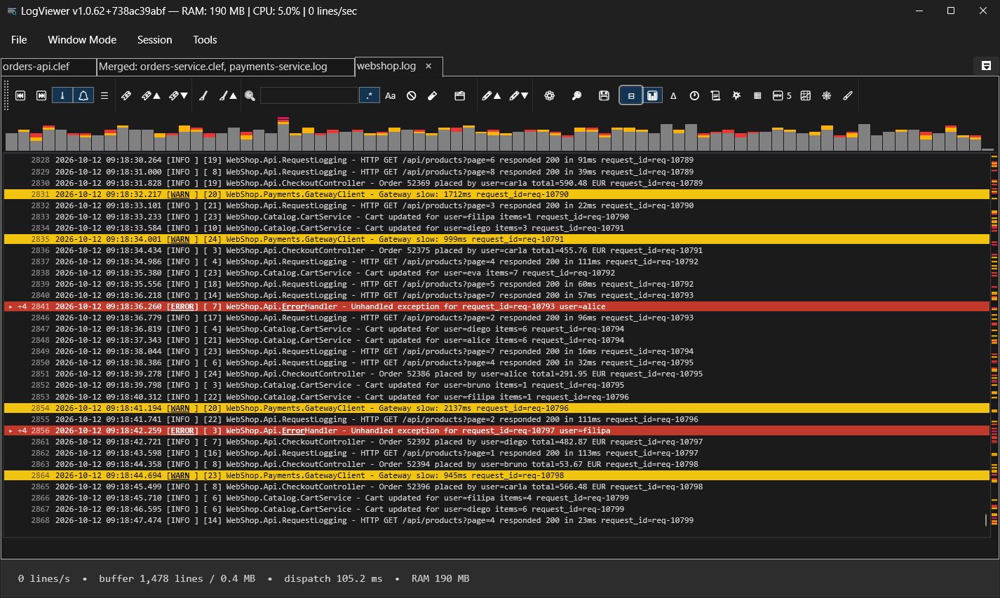

- [Download the latest release](https://github.com/norbertomartins/LogViewer/releases/latest): a single self-contained
  `LogViewer.App.exe` for Windows x64. You don't need to install .NET.
- [Source code and build instructions](https://github.com/norbertomartins/LogViewer)

---

## Contents

1. [Log sources](#log-sources)
2. [Structured logs](#structured-logs)
3. [Distributed tracing (SerilogTracing)](#distributed-tracing-serilogtracing)
4. [Filtering](#filtering)
5. [Time navigation](#time-navigation)
6. [Highlighting, alerts and bookmarks](#highlighting-alerts-and-bookmarks)
7. [Exceptions and stack traces](#exceptions-and-stack-traces)
8. [Search and very large files](#search-and-very-large-files)
9. [Analysis](#analysis)
10. [Export and sharing](#export-and-sharing)
11. [Windows, sessions and the command palette](#windows-sessions-and-the-command-palette)
12. [Customization](#customization)
13. [MCP server for AI agents](#mcp-server-for-ai-agents)
14. [Keyboard shortcuts](#keyboard-shortcuts)

---

## Log sources

Every source is tailed the same way. New lines arrive in batches and a throttled UI refresh renders them, so
even very busy logs stay responsive.

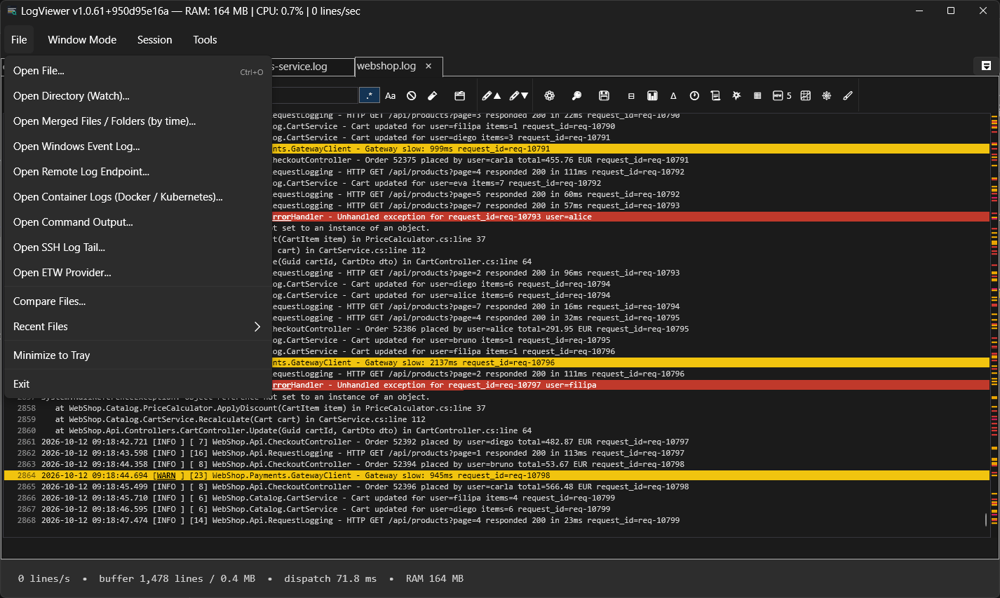

| Source | What it does |
|---|---|
| **Text files** | Incremental tailing that never rereads the file from the start. Encodings are detected automatically. If the file is truncated, rotated or deleted, LogViewer recovers without reopening it. |
| **Compressed files** | `.gz`, `.bz2`, `.zst` and `.zip` open directly. For a zip with several files, you pick the entry. |
| **Directory watch** | Watches a folder with a wildcard (for example `app-*.log`) and switches to the newest matching file when it appears. |
| **Merged files / folders** | Combines several files, from any folders, into one view ordered by timestamp. Each line has a short label showing which file it came from. |
| **Windows Event Log** | Tails `Application`, `System` or any custom channel, with combinable regex filters. |
| **Remote HTTP(S) / WebSocket** | Streams Server-Sent Events, chunked or polled HTTP, or a WebSocket. You can add custom headers, and LogViewer reconnects automatically. |
| **Command output** | Tails the stdout/stderr of any command, such as `journalctl -f`, `docker logs -f`, `kubectl logs -f` or `adb logcat`. It relaunches follow-style commands when they exit. |
| **Containers** | Pick a running Docker container or Kubernetes pod (context, namespace, container) from a list and follow its logs. |
| **SSH** | Runs a command on a remote host and tails its output. Supports key or password authentication and verifies the host-key fingerprint. Credentials are never saved to disk. |
| **ETW** | Tails a real-time Event Tracing for Windows provider by name or GUID. This one needs Administrator rights. |

**Merged view.** This example interleaves a Serilog CLEF file and a plain-text log by timestamp. The **Δ** column
shows the time since the previous line, and the volume timeline sits above the log:

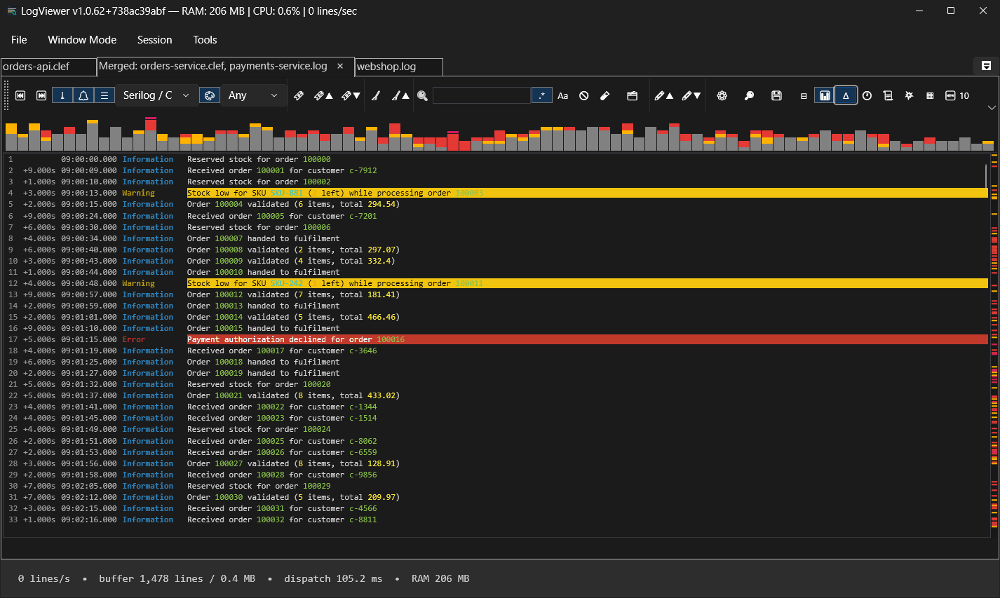

---

## Structured logs

LogViewer detects the log format when it opens a file and parses each line into timestamp, level, message,
exception and properties. Built-in formats:

- **Serilog / CLEF** (compact JSON)
- **logfmt** (`key=value`)
- **JSON lines / NDJSON**: Microsoft.Extensions.Logging JSON console, pino, Bunyan, Winston, zap
- **syslog**: RFC 5424 and legacy BSD (RFC 3164)
- **W3C Extended / IIS**

The detected format appears in a toolbar picker. You can override it per document, and the choice is kept
after a restart. Select a line to see all of its properties in the detail panel. Values in the message can
be colorized by property.

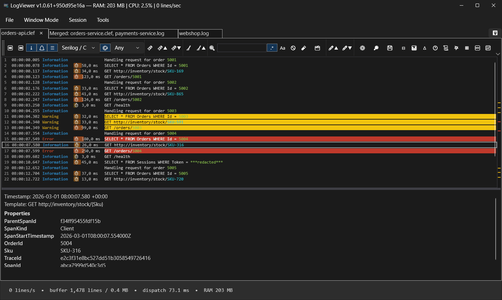

**Custom formats** (*Tools ▸ Custom Log Formats*): define your own format with a regex that uses named groups
(`timestamp`, `level`, `message`, `exception`, `traceid`, …). Any other named group becomes a property you can
filter on. The editor shows a live preview against lines from the current document and includes ready-made
examples for log4j/logback, Python logging and nginx/Apache access logs. You can also choose to join
continuation lines (lines that don't match) to the entry above them.

**Column view**: shows structured events as a table. Choose which properties become columns, sort by any
column (numbers sort numerically), and filter by a cell's value. Double-click a row to jump to its line.

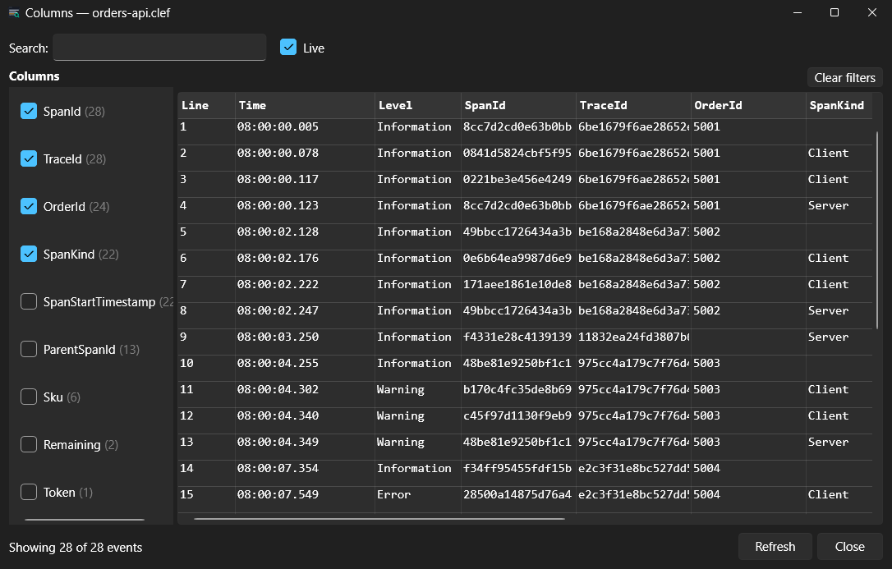

---

## Distributed tracing (SerilogTracing)

LogViewer understands spans produced by [SerilogTracing](https://github.com/serilog-tracing/serilog-tracing):

- Span rows show a **⏱ duration** badge with a bar proportional to the span's length.
- The **Trace Tree** panel shows the parent/child span hierarchy of a trace, colored by level. Double-click a
  span to jump to its line.
- Right-click a line and choose **Filter by TraceId / SpanId** to see every line from that request.

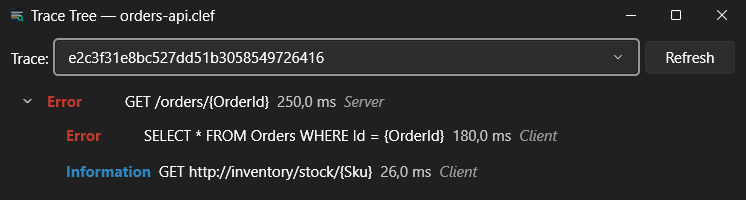

---

## Filtering

- **Live text filter**: show only, or hide, lines that match a substring or a regex. It applies to new lines
  as they arrive and works in both the plain and the structured view.
- **Minimum level** filter for structured logs.
- **Filter by correlation ID**: right-click any line to filter by a trace, request, correlation, operation or
  session id, a W3C `traceparent` header or a GUID found in that line. This works on plain-text logs too, and
  can apply to **every open document** at once.
- **Time-range filter**: show only lines between two times (see [Time navigation](#time-navigation)).
- **Filter views**: save a combination of text, level, property, correlation and time filters under a name,
  then apply it to any document.
- **Pattern tester**: paste sample lines next to the filter box and see live what your regex matches.

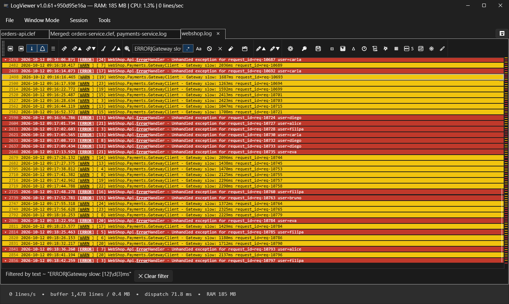

---

## Time navigation

- **Δ column**: time elapsed since the previous line, or since a reference line you choose.
- **Go to time**: an absolute time (`2026-09-23 14:05`, `14:05:30`) or a time relative to the newest line
  (`-5m`, `-1h30m`).
- **Time-range filter** with *From* / *To*. Stack-trace lines stay with the entry they belong to.
- **Volume timeline**: a histogram of errors, warnings and info lines over time. Click a bar to jump there, or
  right-click it to filter to that interval. Volume and error spikes are marked.

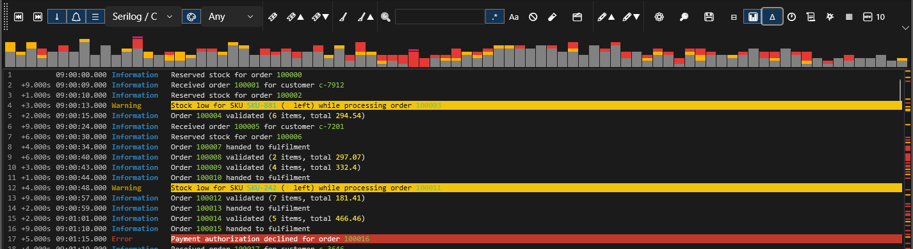

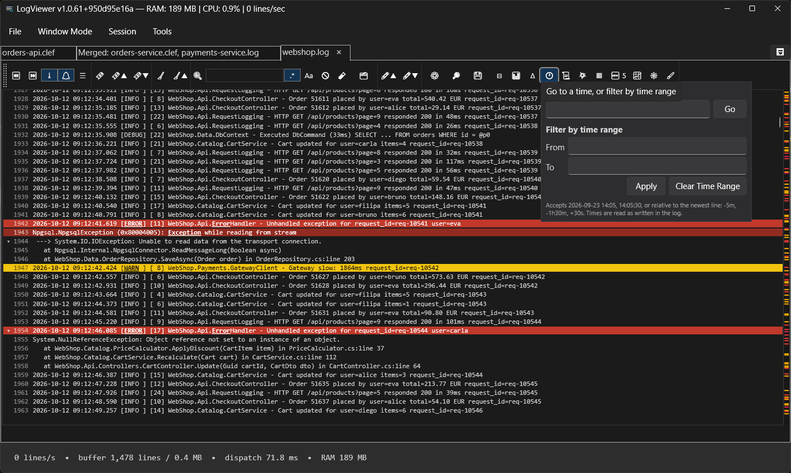

---

## Highlighting, alerts and bookmarks

- **Highlight rules**: a keyword or regex, a priority, and foreground/background colors (separately for the
  light and dark themes). The exact matched text can also be shown in **bold + underline**.
- **Presets**: "Errors & Exceptions" and "Serilog Levels" are built in. You can create your own presets and
  export/import them. Rules can target a single structured property.
- **Alerts**: a rule can raise a desktop notification when it matches *N* times within *T* seconds. You can
  also play a sound on Error/Fatal lines (per window) and be notified when a **new kind** of warning or
  error appears.
- **Bookmarks**: toggle, next and previous bookmark from the keyboard. You can bookmark every result of a
  search or every occurrence of an exception in one go.
- **Notes**: add a note to any line. Notes are kept per file across sessions and only show while the line
  still has the text the note was written on.
- **Overview strip**: a marker strip beside the scrollbar shows where the errors, warnings, bookmarks,
  highlights, new error patterns and search hits are in the document.
- **External tools**: run any program on the selected line with `{FilePath}`, `{LineNumber}` and `{LineText}`
  placeholders, either manually or automatically when a highlight rule matches.

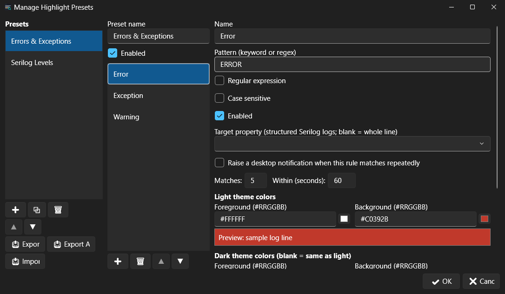

---

## Exceptions and stack traces

- **Collapse stack traces**: a log line and its stack trace show as one row. Click **▸ +N** to expand it.
  This recognises .NET and Java traces (`--->`, `Caused by:`, `... N more`) and Python tracebacks.
- **Exceptions panel**: groups identical exceptions by type and top frames and shows how often each
  occurred, where it first and last appeared, and a sample trace. You can bookmark every occurrence. The
  panel can cover the live buffer (updated as lines arrive) or the whole file.

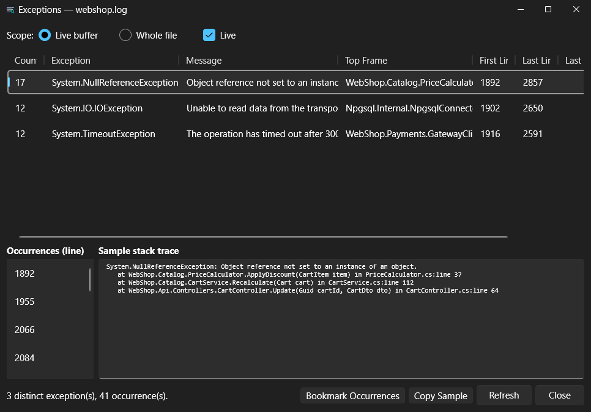

---

## Search and very large files

- **Full-text search** across the whole file, not just the lines currently in memory. It runs in the
  background, can be cancelled, and the tail keeps updating while it runs. It can also search a whole
  Event Log channel.
- **Whole-file browser**: scroll, go to line, go to time and search anywhere in a **multi-GB** file with
  little memory use. It keeps a sparse line index (cached on disk) and only loads the lines on screen.
- **Smart auto-scroll**: scroll up to pause following. A "N new lines — resume follow" banner counts what
  arrived in the meantime, and scrolling back to the bottom resumes following.

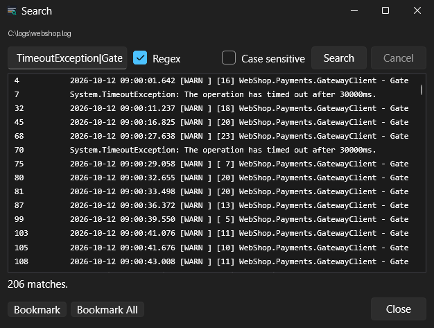

---

## Analysis

- **Statistics**: line, error and warning counts, lines per second, and the most frequent message patterns.
  Click a pattern to jump to its first occurrence.
- **Anomaly detection**: flags error/warning messages of a kind not seen before in the document, and volume
  spikes compared with the recent average.
- **Block diff / similarity**: extract a block of related lines (for example one request) and find similar
  blocks, or compare two runs of the same flow side by side.
- **Compare Files**: a whole-file diff of two logs built on the same block-diff engine, with
  added, removed and changed lines color-coded. Click a line to open it in the live view.

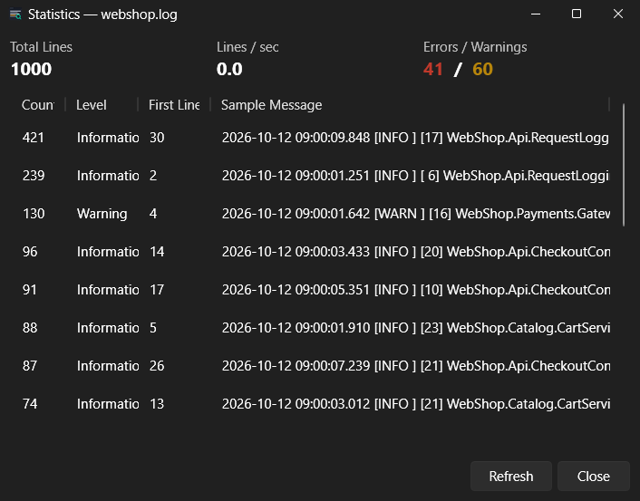

---

## Export and sharing

- Export the visible (filtered) or selected lines to a file, or copy them to the clipboard as plain text or as
  **structured JSON**.
- **Incident report** (*Export ▸ Incident Report…*): the bookmarked, annotated and selected lines with
  surrounding context, plus the file's most frequent exceptions. Saved as Markdown or a self-contained HTML
  page.

---

## Windows, sessions and the command palette

- **Three window modes**: Tabbed, Floating (docking) and classic **MDI** with cascade/tile. Switching modes
  never loses your scroll position, highlights, bookmarks or the live tail.
- **Session restore**: open documents, filters, window layout and the active tab come back on the next start.
- **Session profiles**: save a set of documents, window mode, layout and filters under a name and switch
  between profiles.
- **Command palette** (`Ctrl+P`): fuzzy search across every menu action, open document and document
  command.
- Drag and drop files or folders onto the window, and minimize to the tray. Each tab shows a change
  indicator when its file is updated.

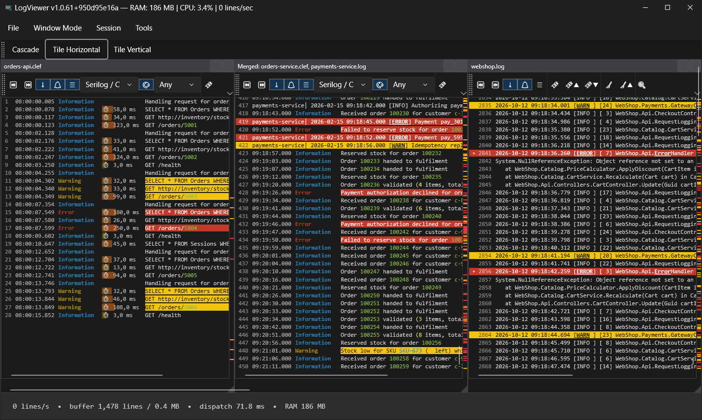

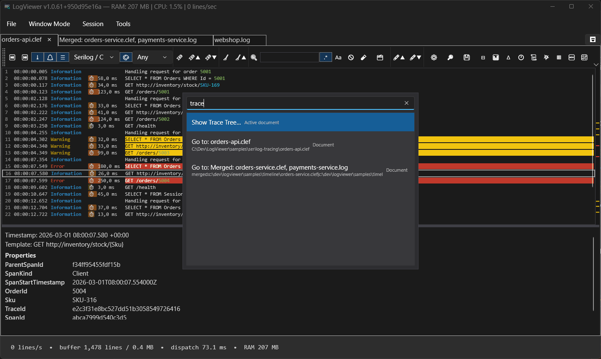

---

## Customization

- **Light and Dark** themes, plus a theme editor for your own colors.
- Log font size (also `Ctrl` + mouse wheel), and a custom color and icon per document.
- **Languages**: English and Português (Portugal).
- Tuning for Remote Desktop: the UI refreshes less often over RDP to save bandwidth.
- A status bar showing throughput, buffer use, UI dispatch latency and process memory.
- **Windows Services**: list services and start or stop them without leaving the app.

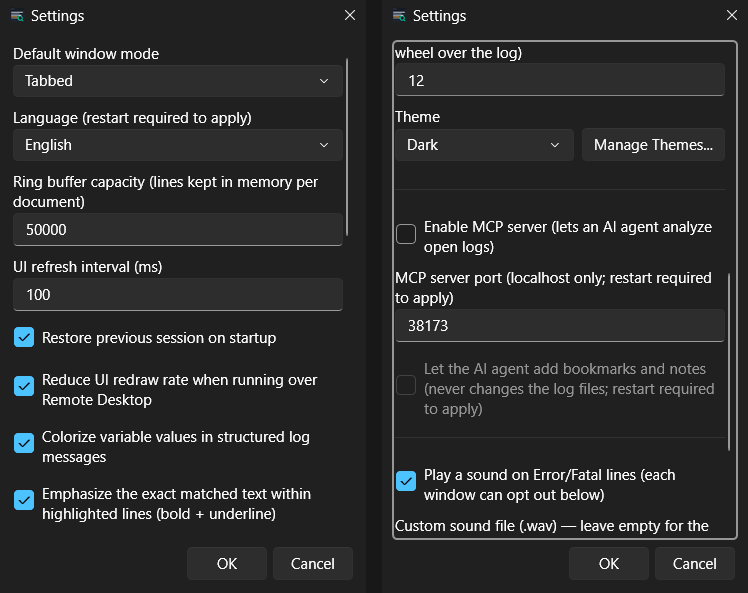

---

## MCP server for AI agents

LogViewer includes a [Model Context Protocol](https://modelcontextprotocol.io) server (Streamable HTTP on
`localhost`, **disabled by default**). Enable it in *Settings* and any MCP client, such as Claude Code or
Claude Desktop, can query the logs you have open:

| Tool | Purpose |
|---|---|
| `logs_list_open_documents`, `logs_describe_source` | Find out what is open and what format it uses |
| `logs_search`, `logs_get_line_context`, `logs_query_time_range` | Search, read the lines around a match, read a time window |
| `logs_get_new_lines_since` | Follow a file with a cursor without rereading it |
| `logs_top_patterns`, `logs_pattern_occurrences`, `logs_top_error_sources` | The most frequent messages and the code locations logging the most errors |
| `logs_list_structured_properties`, `logs_top_property_values` | Explore structured properties |
| `logs_exception_groups` | Distinct exceptions and stack traces |
| `logs_scan_blocks`, `logs_find_similar_blocks` | The block-diff / similarity engine |
| `logs_get_bookmarks`, `logs_get_notes`, `logs_get_alerts` | Your bookmarks, notes and alerts |
| `logs_add_bookmark`, `logs_add_note` | *(separate opt-in)* Let the agent add bookmarks and `[AI]` notes |

Every tool caps how many results it returns and how long each line can be, and the server never changes
your log files. An optional API key header can be required.

---

## Keyboard shortcuts

| Shortcut | Action |
|---|---|
| `Ctrl+O` | Open file |
| `Ctrl+P` | Command palette |
| `Ctrl+Shift+F` | Search the whole file / channel |
| `Ctrl+F2` | Toggle bookmark |
| `F2` / `Shift+F2` | Next / previous bookmark |
| `F3` / `Shift+F3` | Next / previous highlighted line |
| `Ctrl` + mouse wheel | Change the log font size |

---

LogViewer is a WPF application for Windows, built on .NET 10. Screenshots use the built-in Dark theme.
